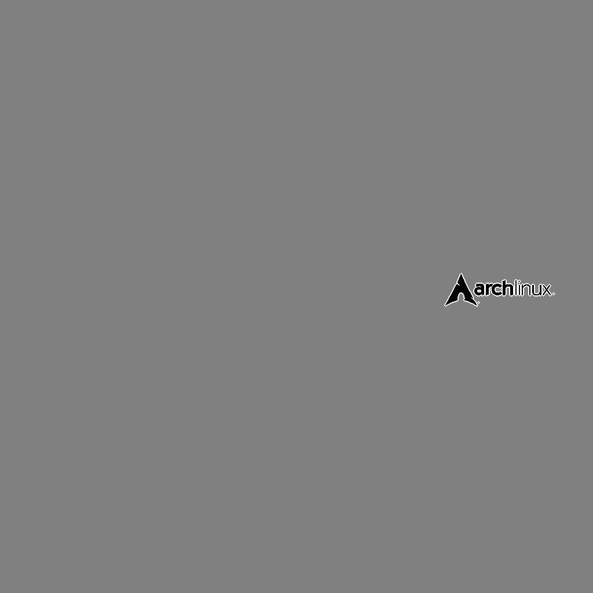
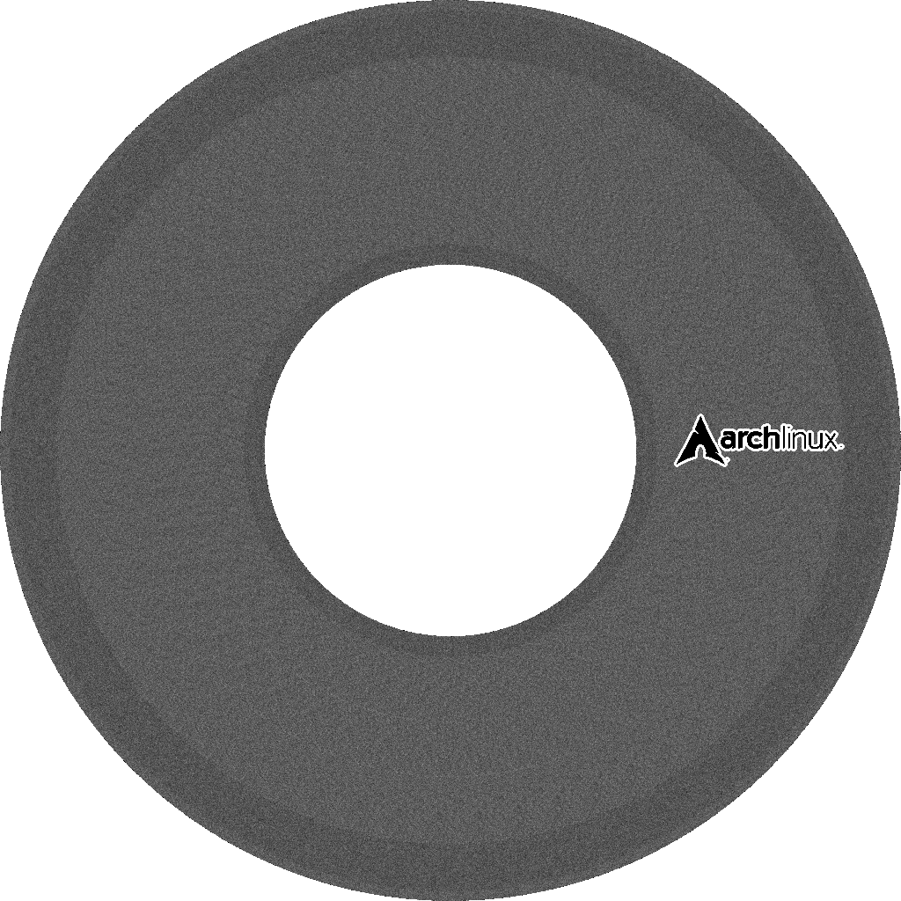
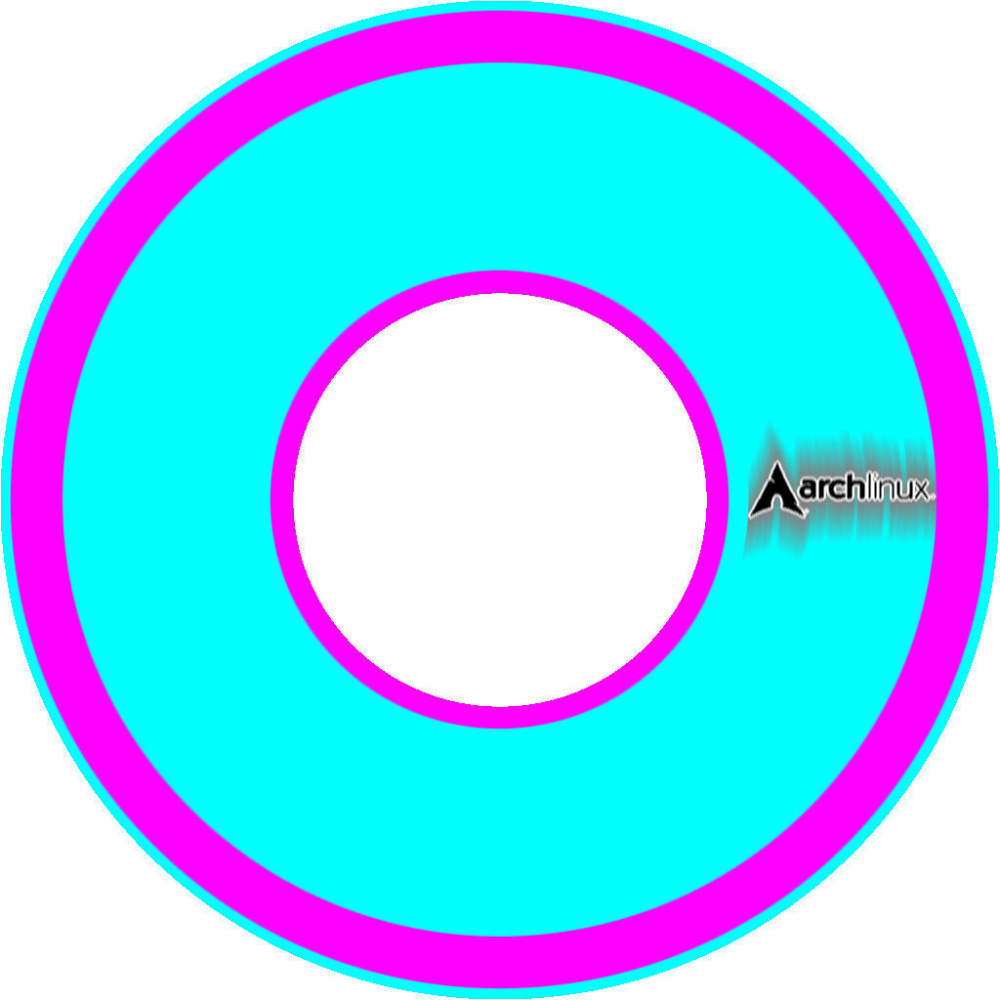

# Arch Linux install ISO → picture hybrid disc

`convert-archiso.sh` converts an Arch Linux install ISO (archiso) into a
picture hybrid disc with the shared [`convert-live-iso.sh`](../convert-live-iso.sh)
(see [the examples README](../README.md) for the two modes, what the
converter does, its prerequisites and options). In both modes nothing on the
medium is modified.

## Preview

| Cover | Simulated Preview | Area Allocation |
|-------|-------------------|-----------------|
|  |  |  (Cyan: Free Space; Magenta: Data) |

## Usage

```sh
./convert-archiso.sh -s preview.png archlinux-2026.11.01-x86_64.iso arch-picture.iso
```

## Notes

- **Boot chain.** BIOS: syslinux (`boot/syslinux/isolinux.bin`) reads its
  configuration from the bridge by Rock Ridge names (it needs
  `archiso_sys-linux.cfg`, which plain ISO9660 identifiers cannot hold) and
  loads the kernel and initramfs from `arch/boot/`. UEFI never reads the ISO9660 tree
  before Linux: the EFI image — a 109 MiB ESP with systemd-boot, the kernel
  and the initramfs, hidden in the original — is extracted to
  `EFI/archiso/efiboot.img`, where older archiso releases kept it. Its size
  overflows the 16-bit El Torito load size, so the catalog records 0 like the
  original. The archiso hook then looks for the medium by
  `archisosearchuuid`; the new volume's UUID differs, so it falls back to
  searching removable devices for `/boot/<uuid>.uuid`, which finds the disc,
  and mounts it as UDF (blkid's pick) — so the bridge mode needs no
  `--prepare`.
- **Secure Boot:** the official Arch ISO does not support it, and neither
  does the converted disc.
- **Cover.** `make-cover.sh` regenerates `cover.png` from the official
  monochrome logo of [archlinux.org/art](https://archlinux.org/art/), black
  with a white halo, at the size and position of the Debian example's logo.
  With it `airootfs.sfs` (about 1 GiB) lies whole in the band outside the
  logo.
- **Trademark.** The Arch Linux name and logo are trademarks of the Arch
  Linux project ([trademark policy](https://terms.archlinux.org/docs/trademark-policy/)).
  The cover keeps the logo's ™ marks (at this size they are dots).

Verified with `archlinux-2026.11.01-x86_64.iso` in QEMU, both modes: BIOS
(syslinux) and UEFI (OVMF, systemd-boot) boot the live system, which mounts
the disc as UDF and passes `sha512sum -c airootfs.sha512`.
