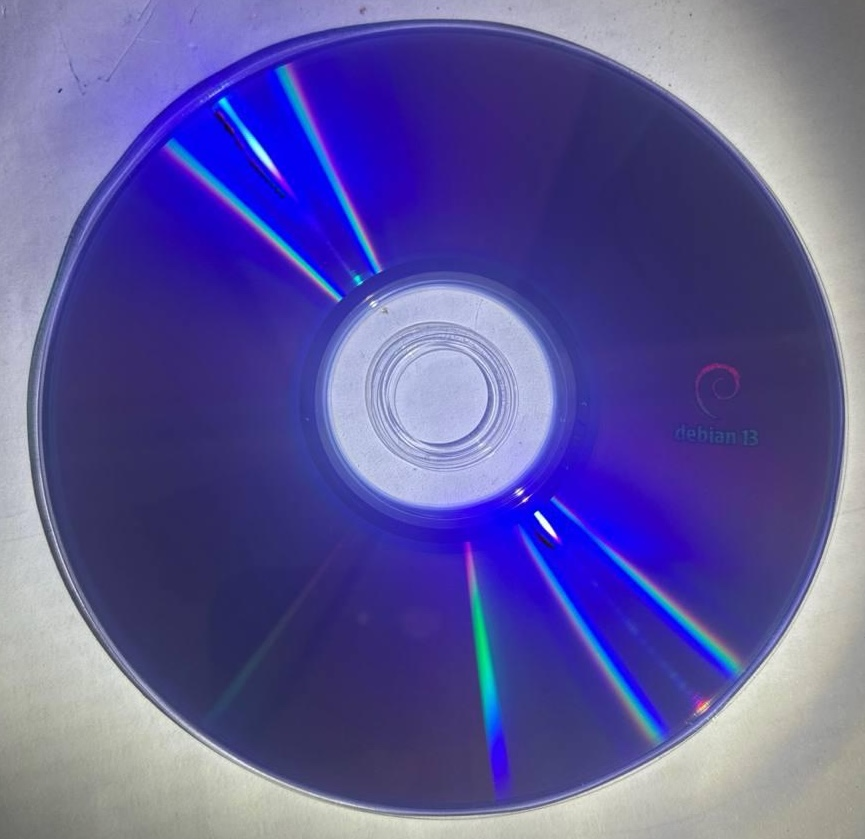
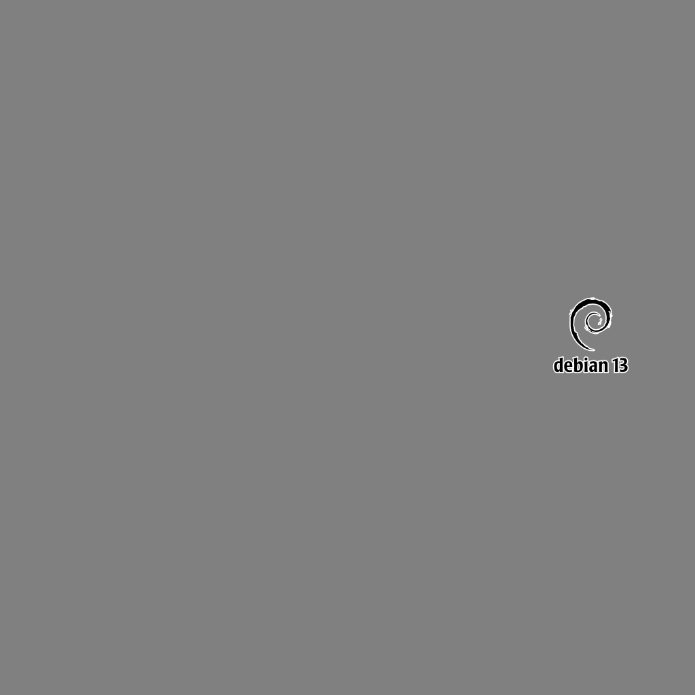
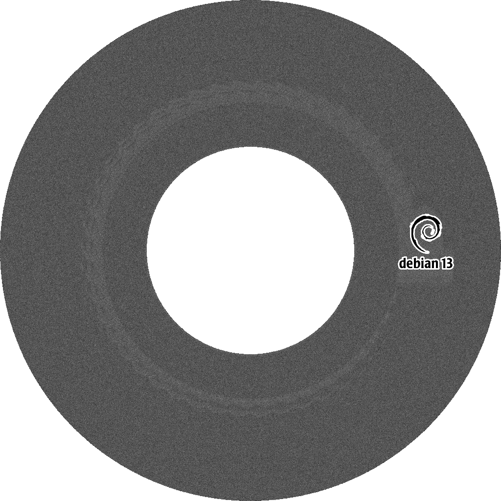
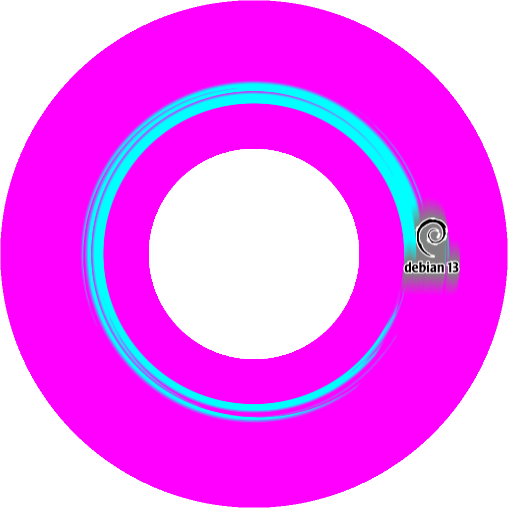

# Debian installer → picture hybrid disc

`convert-debian-iso.sh` converts a Debian installer ISO into a picture hybrid
disc with the shared [`convert-live-iso.sh`](../convert-live-iso.sh) (see
[the examples README](../README.md) for the two modes, what the converter
does, its prerequisites and options). Neither mode modifies isolinux or GRUB,
so UEFI Secure Boot keeps working.

## Preview



| Original Cover | Simulated Preview | Area Allocation |
|----------------|------------------|-----------------|
|  |  |   (Cyan: Free Space; Magenta: Data) |

## Usage

```sh
./convert-debian-iso.sh -s preview.png debian-13.x-amd64-netinst.iso debian-picture.iso
./convert-debian-iso.sh --udf-full debian-13.x-amd64-netinst.iso debian-picture.iso
```

## Notes

- **Boot chain.** BIOS: isolinux (`isolinux/isolinux.bin` with its Boot
  Information Table) loads the kernel and initrd from `install.amd/`. UEFI:
  GRUB from the ESP `boot/grub/efi.img` (a file of the tree) finds the disc
  by `/.disk/id/<uuid>` and reads `boot/` and `install.amd/`. All of these
  are on the bridge, so neither boot loader needs UDF.
- **Bridge mode (default).** debian-installer's `cdrom-detect` mounts the
  disc as iso9660, where the archive (`pool/`, `dists/`) is missing.
  [`prepare-udf.sh`](prepare-udf.sh) appends an overlay to
  `install.amd/initrd.gz` and `install.amd/gtk/initrd.gz` — the
  `udf-modules` udeb and a startup hook switching `cdrom-detect` to udf —
  and updates their `md5sum.txt` lines.
- **`--udf-full`.** Nothing is modified: `cdrom-detect` mounts the disc as
  iso9660 and reads the whole archive from the full Rock Ridge tree
  (symlinks such as `dists/stable -> trixie` included). Boot the disc
  directly.
- An earlier version of this example also patched GRUB (`udf.mod` and
  `insmod udf`), which the signed GRUB refuses under Secure Boot. Putting all
  of `boot/` on the bridge makes that unnecessary.
- `cover.png` is a generated placeholder — drop your own cover over it.

Verified with `debian-13.7.0-amd64-netinst.iso` in QEMU, both modes: BIOS,
UEFI and UEFI Secure Boot reach debian-installer, which mounts `/cdrom` (as
udf in bridge mode, iso9660 with `--udf-full`) and passes
`md5sum -c md5sum.txt`. On a cover fragmenting 357 files (up to 97
sections), the `--udf-full` disc still passed all 933 files.
