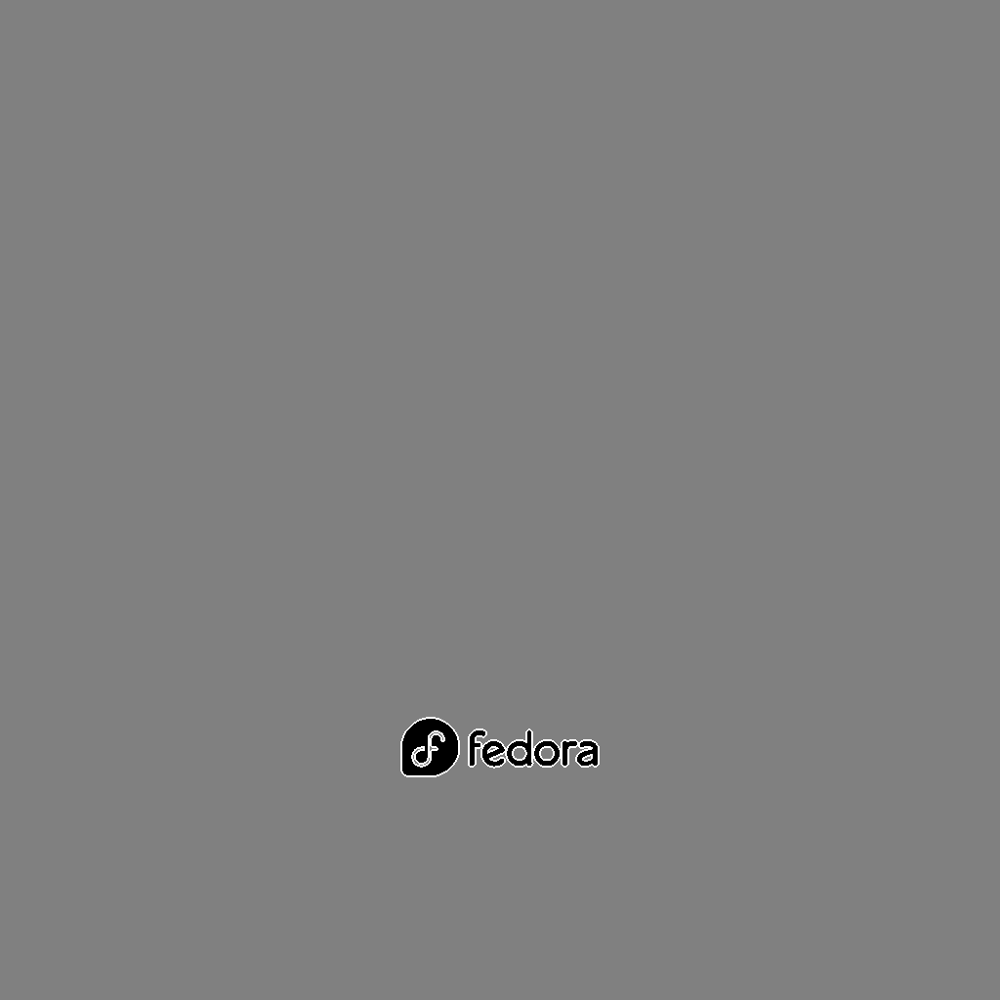
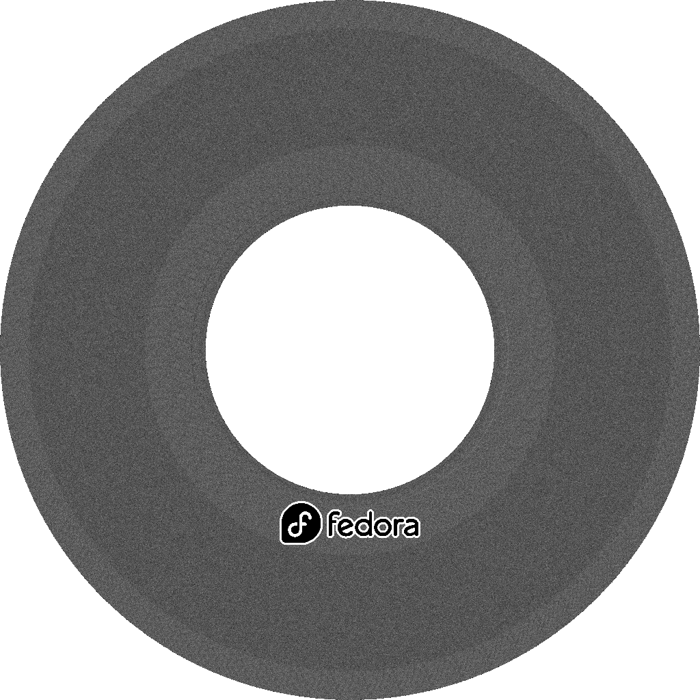
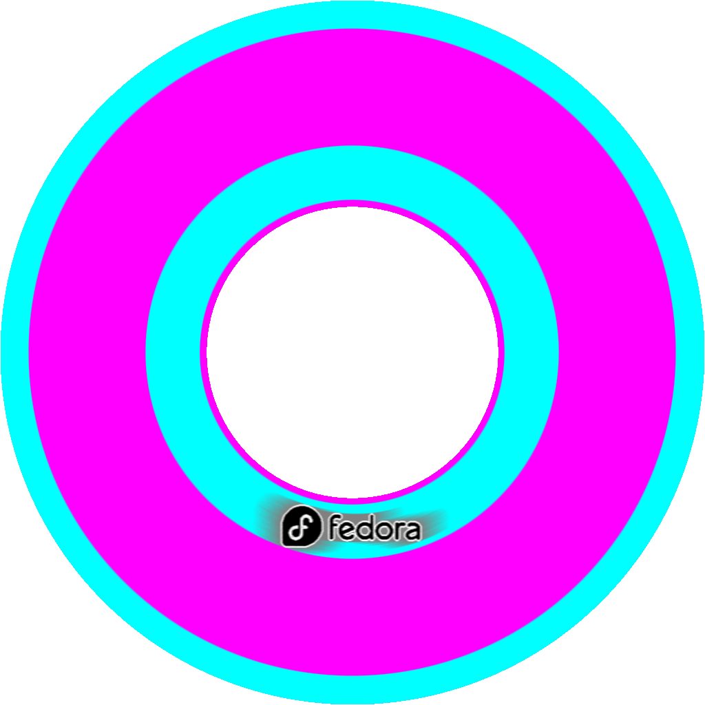

# Fedora live ISO → picture hybrid disc

`convert-fedora-iso.sh` converts a Fedora live ISO (e.g. Fedora Workstation
Live) into a picture hybrid disc with the shared
[`convert-live-iso.sh`](../convert-live-iso.sh) (see
[the examples README](../README.md) for the two modes, what the converter
does, its prerequisites and options). In both modes no Fedora file is
modified, so UEFI Secure Boot keeps working. Needs `implantisomd5`
(`isomd5sum`).

## Preview

| Cover | Simulated Preview | Area Allocation |
|-------|-------------------|-----------------|
|  |  |  (Cyan: Free Space; Magenta: Data) |

## Usage

```sh
./convert-fedora-iso.sh -s preview.png Fedora-Workstation-Live-45-1.4.x86_64.iso fedora-picture.iso
```

## Notes

- **Boot chain.** BIOS: GRUB2's `boot/x86_64/loader/eltorito.img`, with the
  Boot Information Table and the GRUB2 boot info (the image's start + 5 at
  byte 2548, where its cdboot reads the rest of core.img from) and load
  size 4, like the original. UEFI: shim + GRUB from the ESP, hidden in the
  original and extracted to `boot/x86_64/efi`, where Kiwi used to put it.
  GRUB finds the disc with `search --file /boot/0x…` and reads its
  configuration, the kernel and the initrd from the ISO9660 tree. The kernel
  command line then finds the disc by label
  (`root=live:CDLABEL=Fedora-WS-Live-45`) — the UDF volume keeps it
  verbatim — and dracut mounts it as UDF (blkid's pick; the initramfs ships
  `udf.ko`), so the bridge mode needs no `--prepare`.
- **Media check.** The default boot entry, "Test this media & start", runs
  `checkisomd5` against the MD5 implanted in the primary volume descriptor
  and halts the boot if there is none ("Media check failed!"); the converted
  disc gets a new one. It covers the whole volume, picture sectors included,
  so on a burned disc every sector must read back; otherwise pick "Start
  Fedora-Workstation-Live".
- **Cover.** `make-cover.sh` regenerates `cover.png` from the official
  one-color horizontal logo of the
  [Fedora brand standards](https://docs.fedoraproject.org/en-US/project/brand/),
  unaltered, black with a white halo, right below the center hole, so that
  `LiveOS/squashfs.img` (2.6 GiB) lies whole in the plain band outside it.
- **Trademarks.** Fedora® and the Fedora logo are trademarks or registered
  trademarks of Red Hat, Inc., or its subsidiaries in the United States and
  other countries. This example is not affiliated with or endorsed by the
  Fedora Project; official Fedora media are available from
  [fedoraproject.org](https://fedoraproject.org/).

Verified with `Fedora-Workstation-Live-45-1.4.x86_64.iso` in QEMU, both
modes: the default entry's media check passes and the live desktop starts
with BIOS, UEFI and UEFI Secure Boot (OVMF with the Microsoft keys).
