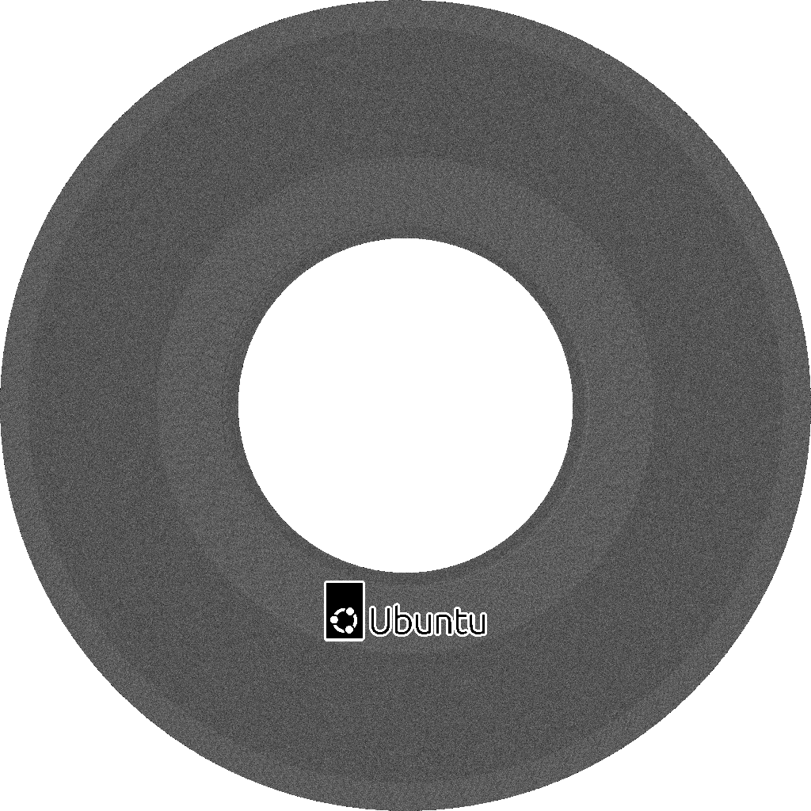

# Ubuntu live ISO → picture hybrid disc

`convert-ubuntu-iso.sh` converts an Ubuntu live ISO into a picture hybrid
disc with the shared [`convert-live-iso.sh`](../convert-live-iso.sh) (see
[the examples README](../README.md) for the two modes, what the converter
does, its prerequisites and options). GRUB is not modified, so UEFI Secure
Boot keeps working.

The example uses **Ubuntu Server** (`ubuntu-26.04.1-live-server-amd64.iso`,
2.9 GB): the Desktop ISO (6.5 GB) does not fit a single-layer 4.7 GB DVD,
and DiscImageStudio does not model dual-layer discs.

## Preview

| Cover | Simulated Preview | Area Allocation |
|-------|-------------------|-----------------|
|  |  |  (Cyan: Free Space; Magenta: Data) |

## Usage

```sh
./convert-ubuntu-iso.sh -s preview.png ubuntu-26.04.1-live-server-amd64.iso ubuntu-picture.iso
./convert-ubuntu-iso.sh --udf-full ubuntu-26.04.1-live-server-amd64.iso ubuntu-picture.iso
```

## Notes

- **Boot chain.** BIOS: GRUB2's `boot/grub/i386-pc/eltorito.img`, with the
  Boot Information Table, the GRUB2 boot info and load size 4 like the
  original. UEFI: shim + GRUB from the ESP, hidden in the original and
  extracted to `boot/grub/efi.img`, where Ubuntu ISOs up to 21.10 kept it.
  GRUB finds the disc with `search --file /.disk/info` and reads its
  configuration, the kernel and the initrd from the bridge. casper then
  looks for the device whose `/.disk/casper-uuid-*` matches the initrd's
  UUID.
- **Bridge mode (default).** casper mounts the disc with the type klibc's
  `fstype` reports first, iso9660, where the squashfs images are missing.
  [`prepare-udf.sh`](prepare-udf.sh) appends an overlay to `casper/initrd`
  in which `get_fstype()` (`scripts/casper-helpers`) reports udf when
  `blkid -p` does, and updates the `md5sum.txt` line, so the boot-time
  integrity check still passes.
- **`--udf-full`.** Nothing is modified: casper mounts `/cdrom` as iso9660
  and the installer runs off the full Rock Ridge tree. Boot the disc
  directly.
- **Cover.** `make-cover.sh` regenerates `cover.png` from the official Ubuntu
  logo SVG of the [Ubuntu brand guidelines](https://design.ubuntu.com/brand/),
  rendered in one color the way the disc shows it — the orange tag and the
  wordmark black, the Circle of Friends white — with a white halo, right
  below the center hole, leaving one plain band for the 1.3 GB squashfs.
- **Trademarks.** Ubuntu and Canonical are registered trademarks of Canonical
  Ltd. This example is not affiliated with or endorsed by Canonical. The
  logo appears under the Ubuntu community provisions of Canonical's
  [IPRights Policy](https://ubuntu.com/legal/intellectual-property-policy)
  (non-commercial discussion, development and advocacy). That policy lets
  Ubuntu be redistributed with the trademarks only unmodified; the converted
  disc is a re-mastered image (in bridge mode with a patched initrd), so
  check the policy before distributing discs.

Verified with `ubuntu-26.04.1-live-server-amd64.iso` in QEMU, both modes:
the installer starts with BIOS, UEFI and UEFI Secure Boot (OVMF with the
Microsoft keys), with `/cdrom` mounted from `/dev/sr0` (as udf in bridge
mode, iso9660 with `--udf-full`) and the boot-time `md5sum.txt` check
passing.
